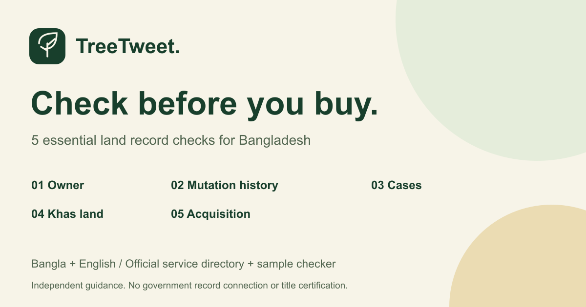
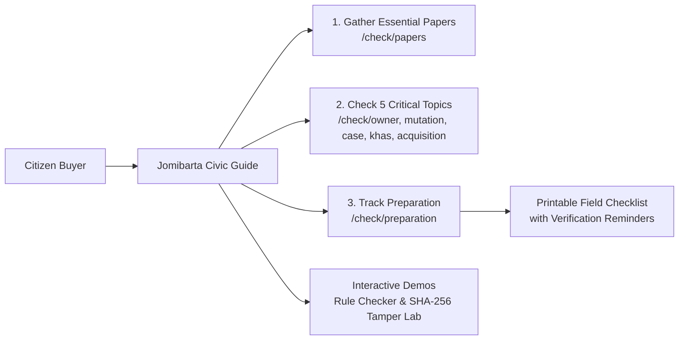

<p align="center">
  <a href="https://jomibarta.vercel.app/">
    
  </a>
</p>

<h1 align="center">জমিবার্তা · Jomibarta</h1>

<p align="center">
  <strong>জমির তথ্য মিলিয়ে দেখুন · Check land records</strong><br>
  <em>A civic-tech guidance portal and pre-purchase verification prototype for land buyers in Bangladesh.</em>
</p>

<p align="center">
  <a href="https://jomibarta.vercel.app/"></a>
  <a href="https://github.com/irfanulhoquetaseen/Jomibarta"></a>
  
  
  
  
</p>

<p align="center">
  <a href="#project-overview">Project Overview</a> •
  <a href="#problem-statement">Problem Statement</a> •
  <a href="#our-solution">Our Solution</a> •
  <a href="#key-features">Key Features</a> •
  <a href="#technology-stack">Tech Stack</a> •
  <a href="#ai-assisted-development-tools">AI Tools</a> •
  <a href="#architecture--how-it-works">Architecture</a> •
  <a href="#getting-started">Getting Started</a> •
  <a href="#team-members">Team</a> •
  <a href="#limitations--responsible-use">Responsible Use</a>
</p>

---

<p align="center">
  
</p>

---

## 📌 Project Overview

**জমিবার্তা (Jomibarta)** is a civic-tech prototype developed by **Team TreeTweet** for **LandTech Hackathon 2026** (Problem Statement **P5: Check Before You Buy**).

In Bangladesh, buying land is often the most significant financial investment an individual or family will make in their lifetime. Yet, navigating complex title chains, legacy survey systems (CS, SA, RS, BS), mutation records, and court injunctions remains intimidating and fraught with fraud risk.

Jomibarta provides:
1. **A Practical, Bengali-First Citizen Guide:** Actionable instructions on what documents to gather, what exact fields to compare, which government offices to consult, and what cautious steps to take if discrepancies are found.
2. **An Interactive Preparation Checklist:** A personal document tracking checklist that runs in-browser and prints neatly without website clutter.
3. **An Educational Verification & Cryptographic Integrity Demo:** A deterministic risk rules engine and a SHA-256 tamper-demonstration lab using synthetic baseline records to illustrate how digital record verification works.

> **Important Disclosure:** Jomibarta is an independent guidance prototype. It does not connect to live government databases and does not certify legal ownership. Sample checker records are fictional.

---

## 🔍 Problem Statement

Property transactions in Bangladesh present severe verification challenges for ordinary citizens:

* **Fragmented Administrative Custody:** Ownership and land identity records are divided across distinct government agencies—deeds are registered at the Sub-Registry Office (Directorate of Registration), khatians and mutations are managed by the Assistant Commissioner (Land) and Union Land Offices (Ministry of Land), court disputes belong to the judiciary, and public acquisitions are managed by District Commissioner (DC) offices.
* **Information Asymmetry:** First-time buyers often do not know which specific documents (CS/SA/RS/BS khatians, via deeds, mutation khatians, DCR, updated land tax receipts / Dakhila) must be gathered from the seller prior to earnest money (বায়না) agreements.
* **False Sense of Security:** Many buyers mistakenly believe that a recent mutation (নামজারি) or an online tax record conclusively proves undisputed ownership. In reality, mutation establishes fiscal possession for revenue collection, not definitive legal title (*swatva*), and cannot override civil court injunctions or prior unrecorded sales.
* **Difficulty in Spotting Red Flags:** Inconsistencies between deed schedules, khatian plot numbers, boundary descriptions (*chouhaddi*), or missing heir transfers are frequently overlooked until after financial commitments have been made.

---

## 💡 Our Solution

Jomibarta transforms complex land administrative procedures into an approachable, transparent, bilingual (Bengali/English) user journey:



1. **Step-by-Step 5 Topic Guides:** Breaks down verification into five core checks:
   - **মালিক ও জমির পরিচয়** (Owner and Land Identity)
   - **নামজারির কাগজ ও ইতিহাস** (Mutation Papers and Chain of Title)
   - **মামলা বা নিষেধাজ্ঞা** (Pending Lawsuits & Court Injunctions)
   - **সরকারি খাস জমি কি না** (Government Khas / Abandoned / Vested Property)
   - **অধিগ্রহণের নোটিশ বা মামলা** (Public Project Acquisition Notices)
2. **Standardized 6-Part Framework per Guide:** Every topic covers:
   - **A. কী যাচাই করবেন:** The core risk in plain language and why it matters.
   - **B. কোন কাগজ বা তথ্য লাগতে পারে:** Practical list of required documents.
   - **C. কীভাবে মিলিয়ে দেখবেন:** Exact field-by-field cross-checking steps.
   - **D. কোথায় যাচাই করবেন:** Verified government offices and official portals.
   - **E. অমিল পেলে কী করবেন:** Safe recommendations (pause transaction, consult counsel).
   - **F. নিজের প্রস্তুতি চিহ্নিত করুন:** Seamless transition to the preparation checklist.
3. **Dedicated Print Output:** A clean, ink-friendly printed checklist for on-site visits to land offices, including note-taking areas and legal disclaimers.
4. **Deterministic Risk Simulator & Cryptographic Lab:** Educates users on how digital title verification, QR code lookup identifiers, and SHA-256 digest checks detect unauthorized record tampering.

---

## 🚀 Key Features

### 1. Citizen Land-Buying Guide (`/check/[topic]`)
* **Owner & Land Identity (`/check/owner`):** Compares seller names, deed serials, khatian Dag/Plot numbers, boundary descriptions (*chouhaddi*), and certified deed copies at the Sub-Registry Office.
* **Mutation & Title Chain (`/check/mutation`):** Instructs how to cross-check seller mutation khatian, DCR (Duplicate Carbon Receipt), and land tax receipts (*dakhila*) via `mutation.land.gov.bd` and `ldtax.gov.bd`.
* **Litigation & Injunctions (`/check/case`):** Guides buyers through checking civil courts, land revenue tribunals (`case.gov.bd`), and cause lists (`causelist.judiciary.gov.bd`). Highlights Section 52 of the Transfer of Property Act (*Lis Pendens*).
* **Government Khas Status (`/check/khas`):** Explains how to identify 1-No. Khas Khatian lands, Enemy/Vested Property schedules (*Ka* and *Kha* lists), and riverbed/char land regulations.
* **Land Acquisition Notices (`/check/acquisition`):** Explains Section 4/7 acquisition notices under the Acquisition and Requisition of Immovable Property Act, and DC office LA branch verification (`larms.land.gov.bd`).

### 2. Preparation Checklist (`/check/preparation`)
* **Truthful Initial State:** Starts completely unmarked for new visitors.
* **Real-Time Progress Counter:** Accurately reflects marked items (e.g., `ব্যক্তিগত প্রস্তুতির অগ্রগতি: ৫টির মধ্যে ২টি চিহ্নিত`) without falsely claiming legal verification.
* **Multi-Status Breakdown:** Differentiates between *Not Yet Marked*, *Missing Papers*, *Papers Gathered (To Compare)*, and *Discrepancy / Assistance Needed*.
* **Safe Local Persistence & Reset:** Preserves selections in browser `localStorage`; includes a confirmation dialog before clearing selections.
* **Clean Print Mode (`@media print`):** Formats checklist into an official paper handout with designated handwriting lines for field notes, while stripping headers, menus, and buttons.

### 3. Sample Verification Engine (Scenarios A–H)
* Evaluates synthetic land parcels against rule-based risk criteria.
* Supports Bengali and English digit normalization (e.g., `০১০১` and `0101`).
* **8 Curated Demonstration Scenarios:**
  * **Scenario A/B:** Clean synthetic baseline records.
  * **Scenario C:** Name spelling variation warning.
  * **Scenario D:** Active bank mortgage warning.
  * **Scenario E:** Critical double-sale / prior transfer conflict.
  * **Scenario F:** Deed seller vs. khatian owner mismatch.
  * **Scenario G:** Excess sold area exceeding recorded khatian share.
  * **Scenario H:** Cryptographic SHA-256 digest mismatch.

### 4. Demo Deed Registration & QR Generator
* Allows testing registration of custom synthetic deed records in browser memory.
* Computes SHA-256 fingerprint from canonical record strings.
* Generates scannable QR codes containing query lookup parameters.
* Maintains isolation between test sessions and protects baseline fixtures from being overwritten.

### 5. Cryptographic Tamper Demonstration Lab
* Hands-on sandbox demonstrating data integrity.
* Edit disposable deed attributes (e.g., area from 5.0 to 9.5 decimals, or alter owner name) and immediately observe how the SHA-256 hash diverges, triggering an integrity alert.

### 6. Bilingual & Accessible User Experience
* Complete Bengali (বাংলা) and English language toggle with remembered user preference.
* Full keyboard navigation, skip links, and ARIA live regions.
* Accessible motion controls respecting system `prefers-reduced-motion`.
* Fully responsive interface optimized from 360px mobile displays up to widescreen desktop monitors.

---

## 🛠️ Technology Stack

| Layer | Technologies |
|---|---|
| **Framework** | [Next.js 16.4.2](https://nextjs.org/) (App Router, Turbopack, React Server Components & Static Site Generation) |
| **UI Library** | [React 19.3.0](https://react.dev/) |
| **Language** | [TypeScript 5](https://www.typescriptlang.org/) |
| **Styling** | [Tailwind CSS v4](https://tailwindcss.com/) & Vanilla CSS Design System (`src/app/globals.css`) |
| **Typography** | Google Fonts ([Noto Sans Bengali](https://fonts.google.com/specimen/Noto+Sans+Bengali)) |
| **Cryptography** | Web Crypto API (Native SHA-256 Digest Engine) |
| **Utilities** | [`qrcode`](https://www.npmjs.com/package/qrcode) (Data URL generation) |
| **Optional Storage** | [`@supabase/supabase-js`](https://supabase.com/) (Optional read-only demo database with RLS) |
| **Testing** | Node.js Test Runner (`node --test`), [`tsx`](https://github.com/privatenumber/tsx), ESLint 9 |

---

## 🤖 AI-Assisted Development Tools

In accordance with transparent development practices, the team utilized AI tools during project planning, authoring, and quality engineering. **None of these AI tools are connected to the live web application or used at runtime to make land ownership decisions.**

* **Antigravity (Google DeepMind Agentic IDE):**
  * Primary agentic coding assistant used across development iterations.
  * Assisted in analyzing codebase architecture, authoring TypeScript modules, refactoring multi-page Next.js App Router structures, implementing the Phase J 6-section guide content, configuring `@media print` stylesheets, and executing comprehensive automated test suites.
* **Claude (Anthropic):**
  * Assisted in early conceptual brainstorming, bilingual terminology mapping (legal terminology in Bengali land administration vs. plain English equivalents), and reviewing citizen safety disclaimers.
* **ChatGPT (OpenAI):**
  * Assisted during initial problem-space exploration, ideation on citizen pain points, and outlining scenario fixtures for the synthetic demonstration engine.

---

## 🏗️ Architecture / How It Works

```
                                 ┌──────────────────────────────────────────────┐
                                 │                Browser Client                │
                                 │  - Next.js App Router (SSG / React 19)       │
                                 │  - Bilingual Context (BN / EN)               │
                                 │  - Preparation Store (localStorage)          │
                                 │  - Print Viewport Filter (@media print)      │
                                 └──────────────────────┬───────────────────────┘
                                                        │
                      ┌─────────────────────────────────┴─────────────────────────────────┐
                      │                                                                   │
                      ▼                                                                   ▼
       ┌───────────────────────────────┐                                   ┌───────────────────────────────┐
       │     P5 Civic Guide Routes     │                                   │   Interactive Demo Workflows  │
       │  /check/owner                 │                                   │  - Search (Scenarios A–H)     │
       │  /check/mutation              │                                   │  - Demo Registration & QR     │
       │  /check/case                  │                                   │  - Tamper Lab (SHA-256)       │
       │  /check/khas                  │                                   └──────────────┬────────────────┘
       │  /check/acquisition           │                                                  │
       │  /check/preparation           │                                                  ▼
       │  /check/papers                │                                   ┌───────────────────────────────┐
       │  /check/help                  │                                   │    Deterministic Engine       │
       └───────────────────────────────┘                                   │  - verifyPlotRules()          │
                                                                           │  - normalizeDagNo/DeedNo()    │
                                                                           │  - SHA-256 digest computation │
                                                                           └──────────────┬────────────────┘
                                                                                          │
                                                        ┌─────────────────────────────────┴─────────────────────────────────┐
                                                        │                                                                   │
                                                        ▼                                                                   ▼
                                         ┌─────────────────────────────┐                     ┌─────────────────────────────┐
                                         │  Bundled Synthetic Fixtures │                     │   Optional Supabase Reads   │
                                         │  (8 baseline test cases)    │                     │   (RLS enabled demo DB)     │
                                         └─────────────────────────────┘                     └─────────────────────────────┘
```

### Deterministic Risk Evaluation Engine
The risk evaluator (`src/lib/verification/`) evaluates record consistency using strict deterministic logic without opaque probabilistic scoring:
* **Seller Match Verification:** Verifies seller name against the recorded khatian owner, applying Bengali honorific normalization (e.g., মোঃ, মোসাম্মৎ, ড.).
* **Mutation Continuity Check:** Validates whether the mutation khatian number and volume register exist, and whether sequential mutation transfers are coherent.
* **Mortgage & Encumbrance Detection:** Flags active institutional charges or court attachments.
* **Double-Sale Detection:** Detects if the same plot has overlapping deeds recorded after a registered transfer.
* **Area Consistency:** Compares deed sold area against the khatian's recorded plot share to catch over-sale anomalies.

### Cryptographic Digest Standard
Each deed's canonical representation is formatted as:
```text
DEED_NO|DAG_NO|SELLER_NAME|BUYER_NAME|AREA_DECIMAL|DATE|PREV_HASH
```
This UTF-8 string is hashed using native Web Crypto SHA-256. Any modification to a single character (e.g., modifying `5.0000` to `9.0000` decimals) produces a completely different 64-character hexadecimal digest, rendering the altered record instantly detectable.

---

## 💻 Getting Started

### Prerequisites
* **Node.js:** `v20.x` or `v22.x` (LTS recommended)
* **Package Manager:** `npm` (v10+)
* **Git**

### Installation

1. **Clone the repository:**
   ```bash
   git clone https://github.com/irfanulhoquetaseen/Jomibarta.git
   cd Jomibarta
   ```

2. **Install dependencies:**
   ```bash
   npm ci
   ```

3. **Start the local development server:**
   ```bash
   npm run dev
   ```
   Open [http://localhost:3000](http://localhost:3000) in your browser.

> **Note:** No external database or API keys are required to run the application in default demo mode. It runs immediately out-of-the-box using synthetic fixtures.

### Optional Supabase Configuration (Read-Only Demo Mode)
If you wish to test with an external PostgreSQL database:
1. Copy the environment template:
   ```bash
   cp .env.example .env.local
   ```
2. Populate `.env.local` with your test database credentials:
   ```env
   NEXT_PUBLIC_SUPABASE_URL=https://your-project.supabase.co
   NEXT_PUBLIC_SUPABASE_ANON_KEY=your-anon-key
   ```
3. Apply the SQL migration from `supabase/migrations/` and optionally seed sample data with `npm run seed`.

---

## 🧪 Available Scripts and Quality Checks

The repository includes a comprehensive automated verification suite:

```bash
# Run all automated test suites (unit, p5, receipts, presentation, motion, hero, preparation, topics, phase-j, hardening)
npm test

# Run TypeScript type safety verification
npm run typecheck

# Run ESLint check
npm run lint

# Run pre-submission verification of baseline cases and tampering detection
npm run verify:submission

# Build optimized production bundle
npm run build

# Start production server locally
npm start
```

### Detailed Test Suites
* `npm run test:cases` — Tests baseline scenario outcomes (Green, Yellow, Red, Null).
* `npm run test:scenarios` — Verifies scenario consistency and mandatory fictional disclosures.
* `npm run test:unit` — Tests Bengali name normalization, phone normalization, and seller verification logic.
* `npm run test:reliability` — Verifies input edge cases, leap dates, and format boundaries.
* `npm run test:p5` — Verifies acquisition, mutation history, and buyer checklist rules.
* `npm run test:receipts` — Validates browser receipt storage bounds and concurrency safety.
* `npm run test:presentation` — Ensures risk captions avoid technical hash jargon.
* `npm run test:motion` — Verifies reduced-motion compliance and observer cleanup.
* `npm run test:hero` — Verifies hero slideshow timer management and visibility pausing.
* `npm run test:preparation` — Tests checklist store integrity, JSON validation, and reset behavior.
* `npm run test:topics` — Tests topic routing guards and bilingual headers.
* `npm run test:phase-j` — Tests Phase J 6-section guide structures and print CSS styles.
* `npm run test:hardening` — Tests malicious input handling and fixture immutability.

---

## 📁 Project Structure

```text
├── docs/                       # Specifications, research notes, and audit reports
├── public/                     # Static assets (icon.svg, social-card.png, webp backgrounds)
├── scripts/                    # CLI scripts (verify-cases.mjs, verify-submission.mjs, seed.mjs)
├── src/
│   ├── app/                    # Next.js App Router (routes, layout, globals.css, sitemap)
│   │   ├── check/              # Multi-page topic guides (/check/[topic])
│   │   │   └── [topic]/        # Dynamic topic page handler
│   │   ├── globals.css         # Global styles, Tailwind utilities, and @media print rules
│   │   ├── layout.tsx          # Root layout with bilingual metadata and extension hydration guards
│   │   └── page.tsx            # Main application landing page
│   ├── components/
│   │   ├── guide/              # Citizen guide components (BuyerGuide, BuyerPortal, GuideDetail, Store)
│   │   │   ├── BuyerGuide.tsx  # Hero section, slideshow, and guide introduction
│   │   │   ├── BuyerPortal.tsx # Guide topic cards and quick action navigation
│   │   │   ├── GuideDetail.tsx # 6-section guide renderer (A-F), checklist, and print sheet
│   │   │   ├── guideTopics.ts  # Core guide definitions and route metadata
│   │   │   └── guideTopicDetails.ts # Detailed bilingual content for all 5 checks
│   │   ├── registration/       # Demo deed registration components
│   │   ├── search/             # Search input and scenario picker components
│   │   ├── tamper/             # Cryptographic tamper demonstration lab
│   │   ├── ui/                 # Reusable navbar, modals, badges, and layout wrappers
│   │   └── verification/       # Verification result cards, issue flags, and inspection views
│   └── lib/
│       ├── crypto/             # SHA-256 Web Crypto hashing functions
│       ├── db/                 # Supabase client and schema definitions
│       ├── demo/               # Synthetic baseline fixtures (Cases A–H) and local registry
│       ├── i18n/               # Language context and translation utilities (useLanguage)
│       ├── services/           # Land verification orchestration service
│       └── validation/         # Input sanitization and Bengali digit/name normalizers
├── supabase/                   # Database migrations and RLS schema definitions
├── tests/                      # Automated test suites (13 distinct test files)
├── LICENSE                     # MIT License
├── package.json                # Project dependencies and test scripts
└── tsconfig.json               # TypeScript configuration
```

---

## 👥 Team Members

**Team TreeTweet** · LandTech Hackathon 2026

* **Irfanul Hoque Taseen** — Team Leader
* **Abdullah Alif** — Team Member

---

## ⚠️ Limitations & Responsible Use

1. **Civic Education Prototype:** Jomibarta is a hackathon prototype designed for educational and civic-guidance purposes. It is **not** an official government agency and is **not** affiliated with the Ministry of Land or Directorate of Registration.
2. **Synthetic Demonstration Data:** All search records, deed numbers, and khatian owners displayed in the sample checker are fictional demo entities created for risk demonstration.
3. **Deterministic Consistency ≠ Legal Title:** A "Green" status or matched SHA-256 fingerprint in the prototype indicates only that the supplied digital data is internally consistent with its recorded baseline. It does **not** certify that the seller possesses marketable legal title, nor does it replace official field record scrutiny.
4. **Meaning of Hash Mismatches:** A cryptographic mismatch proves only that the digital text or attributes of a document differ from the stored fingerprint snapshot. A mismatch indicates an altered record, but does not independently establish fraudulent intent without legal investigation.
5. **Simulated Workflows:** Demo deed registration and mutation simulations occur strictly within client memory / demo scope and do **not** register or modify any real-world government records.
6. **Mandatory Real-World Verification:** Before executing any property transaction or handing over earnest money (*bayna*), buyers must verify physical records at the relevant Sub-Registry Office, AC (Land) office, and Union Land Office, and consult a qualified property lawyer.

---

## 🔮 Future Improvements

* **Official API Integration:** Integrate with official Ministry of Land and Directorate of Registration public verification APIs once secure government endpoints become publicly accessible.
* **National Single Sign-On:** Support authentication via government citizen portals (MyGov / EkSheba).
* **Fractional Inheritance Calculator (হিস্যা ক্যালকুলেটর):** An interactive tool to calculate complex fractional shares (আনা, গন্ডা, কড়া, ক্রান্তি, তিল) from RS/CS khatians into decimal acreage.
* **Offline PWA Support:** Provide field-ready Progressive Web App capabilities for rural land buyers inspecting properties with intermittent connectivity.
* **Regional Tenure Modules:** Add specialized guidance modules for non-standard land tenure zones, including the Chittagong Hill Tracts (CHT Regulation 1900) and coastal char lands (*Payasti/Sikasti*).

---

## 📄 License

This project is open-source and licensed under the [MIT License](LICENSE).
